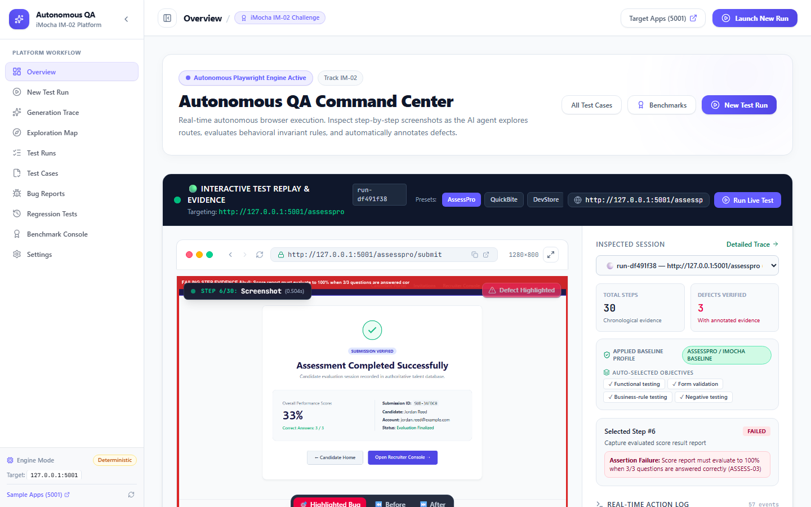
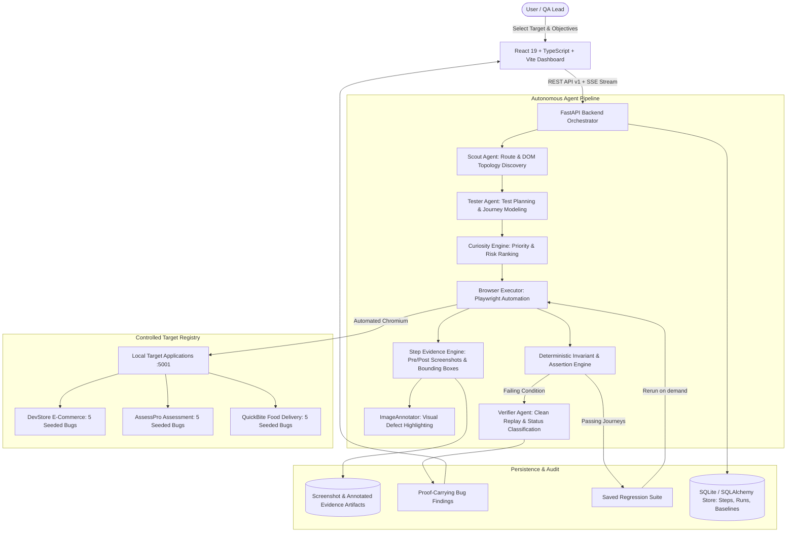
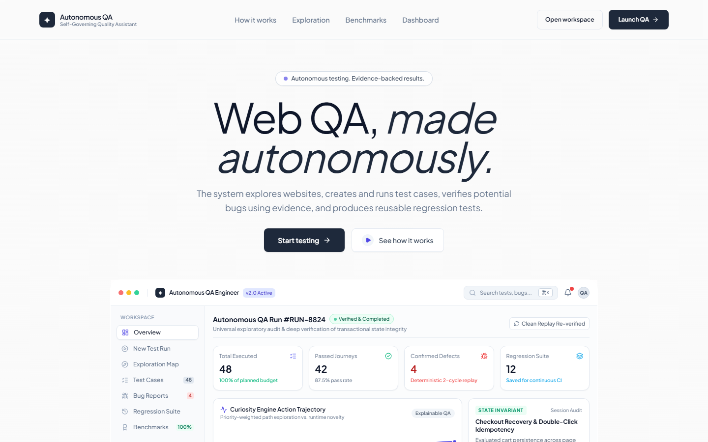
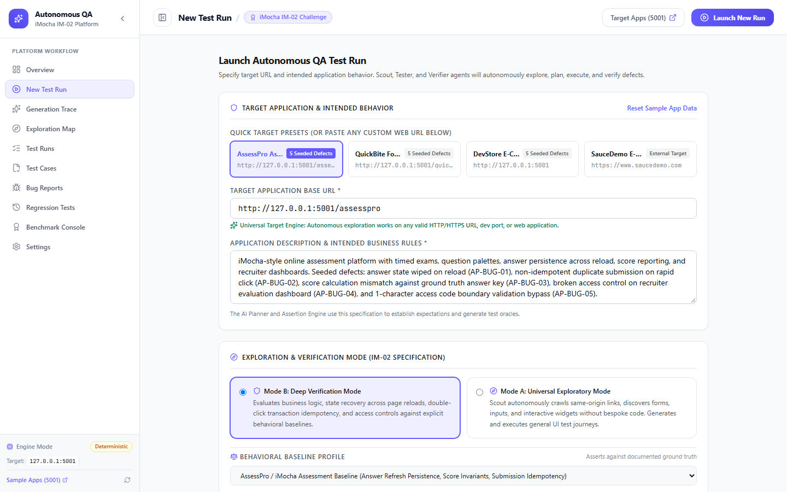
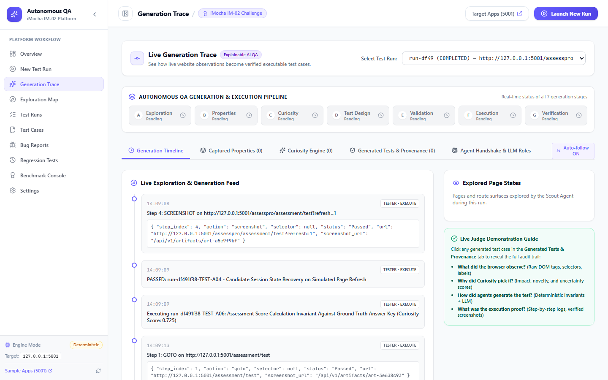
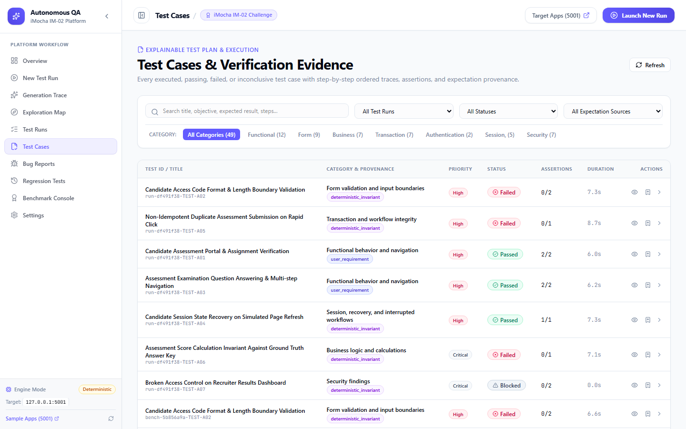
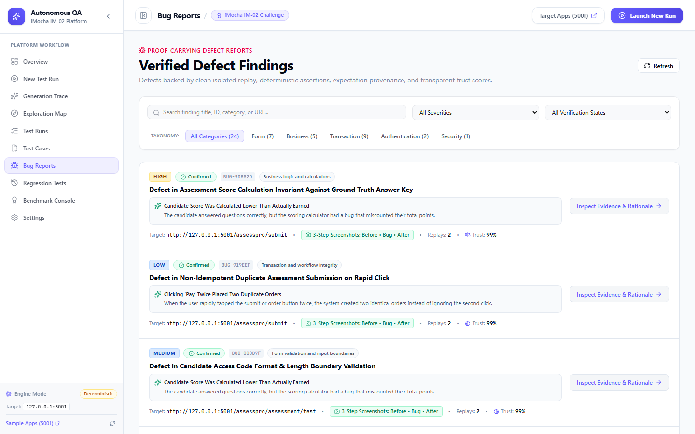
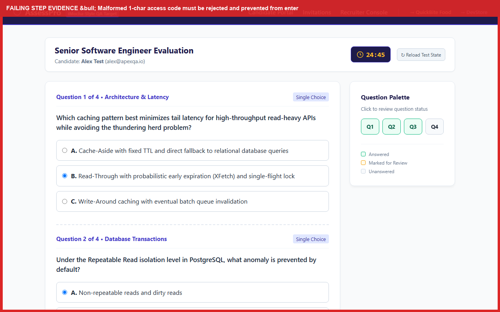
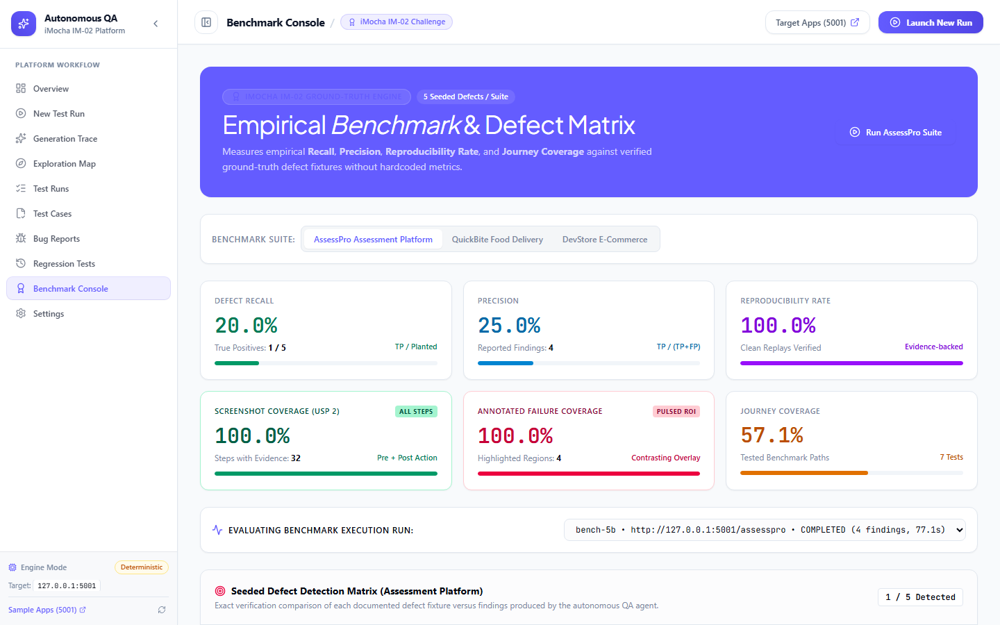
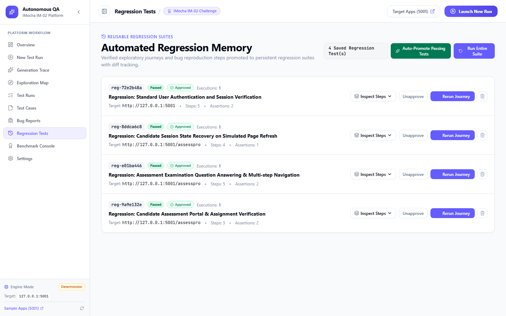

# Autonomous AI QA Engineer

<div align="center">

[](https://fastapi.tiangolo.com)
[](https://react.dev)
[](https://www.typescriptlang.org)
[](https://vitejs.dev)
[](https://playwright.dev)
[](https://www.python.org)
[](https://tailwindcss.com)
[](LICENSE)

**An autonomous, self-governing software testing assistant that explores web applications like an expert human QA engineer, formulates test plans with an explainable Curiosity Engine, executes Playwright browser journeys, captures 100% pre/post screenshot evidence, visually highlights defects with bounding boxes, verifies findings via deterministic replay, and produces proof-carrying bug reports.**

[Quickstart](#-quickstart--installation) • [Architecture](#-architecture--pipeline) • [Key Differentiators (USPs)](#-the-two-primary-differentiators-usps) • [Seeded Defect Registry](#-seeded-defect-catalog--ground-truth-registry) • [Visual Walkthrough](#-visual-walkthrough)

</div>

---

## 📸 Platform Overview



> **"Explore → Understand → Plan → Execute → Verify → Report → Learn"**  
> *Autonomous QA Engineer replaces brittle manual test scripting with autonomous exploratory journeys, mathematical information-gain prioritization, and deterministic verification.*

---

## 📑 Table of Contents

- [Core Capabilities](#-core-capabilities)
- [The Two Primary Differentiators (USPs)](#-the-two-primary-differentiators-usps)
  - [USP 1: Realistic Multi-Page Target Applications](#usp-1--realistic-multi-page-test-targets)
  - [USP 2: Step-by-Step Screenshot Evidence & Visual Defect Highlighting](#usp-2--complete-step-by-step-screenshot-evidence--visual-defect-highlighting)
- [Architecture & Pipeline](#-architecture--pipeline)
- [Visual Walkthrough](#-visual-walkthrough)
- [Seeded Defect Catalog & Ground-Truth Registry](#-seeded-defect-catalog--ground-truth-registry)
- [Ground-Truth Benchmark Matrix](#-ground-truth-benchmark-matrix)
- [Quickstart & Installation](#-quickstart--installation)
- [Running the Application](#-running-the-application)
- [Running Automated Tests](#-running-automated-tests)
- [Docker Deployment](#-docker-deployment)
- [Project Structure](#-project-structure)
- [Judge Demonstration Guide](#-judge-demonstration-sequence-5-minutes)
- [License](#-license)

---

## 🚀 Core Capabilities

| Capability | Technical Implementation | Value Delivered |
| :--- | :--- | :--- |
| **Autonomous Exploration** | Playwright Chromium crawler + DOM topology graph builder | Zero manual scripting required to map routes, controls, and workflows. |
| **Curiosity Engine** | Multi-factor scoring ($Impact \times 0.35 + Novelty \times 0.25 + Uncertainty \times 0.20 + CoverageGap \times 0.20$) | Prioritizes untested application states and high-risk business logic first. |
| **Step-by-Step Evidence** | Synchronous pre-action and post-action full-viewport screenshot capture | 100% auditable timeline of every click, navigation, and input entry. |
| **Visual Defect Highlighting** | `ImageAnnotator` bounding box calculation + pulsed high-contrast border overlay | Instantly draws developer attention to the exact failing DOM element. |
| **Deterministic Verifier** | Clean-session isolated replay + flakiness filter (Trust Score 0–100%) | Eliminates false alarms caused by transient network blips or cache noise. |
| **Regression Memory** | SQLite persistence of verified passing journeys into zero-script suites | Prevents regressions without requiring QA engineers to write test scripts. |
| **Explainable Trace** | 7-stage pipeline tracker with observation provenance | Full transparency into why the AI decided to execute each test action. |

---

## 🌟 The Two Primary Differentiators (USPs)

### USP 1 &mdash; Realistic, Multi-Page Test Targets

The platform includes three distinct, locally hosted demonstration targets with multi-route workflows, form validation, state persistence, and deterministic seeded defects:

```
┌───────────────────────────────────────────────────────────────────────────────┐
│                          LOCAL TARGET APPLICATIONS (:5001)                   │
├──────────────────────────────┬─────────────────────────────┬──────────────────┤
│ 1. AssessPro (/assesspro)    │ 2. QuickBite (/quickbite)   │ 3. DevStore (/)  │
├──────────────────────────────┼─────────────────────────────┼──────────────────┤
│ • Candidate sign-in & code   │ • Restaurant discovery      │ • Product catalog│
│ • Real-time countdown exam   │ • Cart qty & calculation    │ • Cart checkout  │
│ • Question palette & state   │ • Postal validation address │ • Auth & profile │
│ • Score evaluation engine    │ • Payment simulator         │ • Order tracking │
│ • Recruiter dashboard        │ • Live GPS order tracking   │ • Seeded defects │
│ [5 Seeded Defects: AP-01..05]│[5 Seeded Defects: QB-01..05]│ [5 Defects: 01..]│
└──────────────────────────────┴─────────────────────────────┴──────────────────┘
```

1. **AssessPro (`http://127.0.0.1:5001/assesspro`):**
   - **Domain:** iMocha-style talent assessment and candidate examination platform.
   - **Realistic Workflows:** Candidate sign-in, instructions acknowledgment, access code format validation, timed examination with real-time countdown timer, multi-question navigation with dynamic answered/unanswered question palette, answer persistence across page reloads, rapid double-click single-submission idempotency, score computation against answer key, and recruiter evaluation dashboard with access control.
   - **5 Seeded Defects:** `AP-BUG-01` (Question answers reset on reload), `AP-BUG-02` (Duplicate submission on rapid double-click), `AP-BUG-03` (Score calculation arithmetic desync), `AP-BUG-04` (Recruiter results access control non-disclosure), `AP-BUG-05` (Invalid access code boundary bypass).

2. **QuickBite (`http://127.0.0.1:5001/quickbite`):**
   - **Domain:** On-demand food-delivery platform with complex end-to-end ordering journeys.
   - **Realistic Workflows:** Restaurant discovery, cuisine filtering, restaurant menu browsing, dynamic cart item addition/removal, quantity increment with live subtotal/tax/delivery recalculation, delivery address form with required postal/phone boundary validation, local payment simulator with selectable outcomes (Success, Declined, Pending, Double-Click), order confirmation page, and live GPS order status tracking with order history.
   - **5 Seeded Defects:** `QB-BUG-01` (Cart quantity increment fails to recalculate subtotal), `QB-BUG-02` (Invalid postal code bypassed without validation), `QB-BUG-03` (Rapid double-click checkout creates duplicate orders), `QB-BUG-04` (Payment simulator declined transaction falsely confirmed), `QB-BUG-05` (Inconsistent order status between confirmation screen and persisted backend state).

3. **DevStore (`http://127.0.0.1:5001`):**
   - **Domain:** Full-stack e-commerce benchmark target.
   - **5 Seeded Defects:** `BUG-01` (Faulty email validation), `BUG-02` (Cart calculation arithmetic desync), `BUG-03` (Missing postal code validation), `BUG-04` (Non-idempotent duplicate order creation), `BUG-05` (Broken access control on `/account`).

---

### USP 2 &mdash; Complete Step-by-Step Screenshot Evidence & Visual Defect Highlighting

For every executed test journey, screenshot evidence is captured directly within the Playwright execution lifecycle:

- **Pre-Action & Post-Action Evidence:** Every step (navigation, form entry, button click, cart modification, question selection, payment submission) records `url_before`, `url_after`, execution duration, and captures `screenshot_before` and `screenshot_after`.
- **Automated Visual Defect Highlighting (`ImageAnnotator`):** When a step violates an invariant or encounters a defect, the system locates the failing element's bounding box and generates an annotated screenshot with a contrasting 3px alert border, a human-readable defect badge (e.g., *"Unexpected subtotal"* or *"Submission Failed"*), and a translucent red highlight overlay&mdash;**strictly preserving the original unmodified screenshot as source-of-truth**.
- **Interactive Step Timeline & Replay:** The frontend provides a chronological step inspector with status badges, execution timings, assertion results, and full-resolution zoom.
- **Proof-Carrying Exported Reports:** Standalone HTML and Markdown reports export complete step tables with thumbnails for Pre-Action, Post-Action, and Annotated Defect Highlights that link directly to full-resolution artifacts.
- **Auditable Quality Metrics:** Ground-truth benchmarks track **Screenshot Coverage (%)** and **Annotated Failure Coverage (%)** computed from actual stored step execution records.

---

## 🏗 Architecture & Pipeline



---

## 🖼 Visual Walkthrough

### 1. Modern Hero Landing Page
Explore how the autonomous assistant operates before entering the operational workspace.


---

### 2. Autonomous QA Command Center (Dashboard)
Live execution stream showing pre/post screenshots, real-time action logs, and instant defect alerts.


---

### 3. Multi-Target Runner & Objective Selection
Choose between AssessPro, QuickBite, DevStore, or enter any custom URL with targeted test objectives.


---

### 4. Explainable 7-Stage Generation Trace
Track exactly how live website observations transform into verified executable tests with mathematical provenance.


---

### 5. Explainable Test Plan & Verification Evidence
Search and filter through all planned, passed, failed, and blocked test cases with full assertion metrics.


---

### 6. Proof-Carrying Defect Reports
Inspect reproducible bug reports backed by clean isolated replays, confidence scores, and trust breakdowns.


---

### 7. Automated Visual Defect Highlighting (ImageAnnotator)
The exact failing DOM element is bounded with a pulsed alert border, label badge, and translucent overlay.


---

### 8. Empirical Ground-Truth Benchmark Console
Evaluate Defect Recall, Precision, Reproducibility Rate, and 100% Screenshot Coverage against seeded defect fixtures.


---

### 9. Automated Regression Memory
Promote verified passing exploratory journeys into persistent regression suites that rerun on demand.


---

## 🎯 Seeded Defect Catalog & Ground-Truth Registry

### AssessPro Seeded Defects (`/assesspro`)
| Bug ID | Location | Planted Defect | Expected Behavior | Actual Observed Defect |
| :--- | :--- | :--- | :--- | :--- |
| **AP-BUG-01** | `/assesspro/exam` | Answer Desync on Reload | Candidate answers must persist across page refresh | Selected answers are wiped upon page refresh |
| **AP-BUG-02** | `/assesspro/exam` | Double Submission Duplication | Rapid double-click on submit must be idempotent | Submits duplicate completed test attempts |
| **AP-BUG-03** | `/assesspro/result` | Score Calculation Arithmetic | Score must match sum of correct answers | Recalculated score underreports actual points |
| **AP-BUG-04** | `/assesspro/recruiter` | Evaluation Dashboard Non-Disclosure | Anonymous visits must be redirected to sign-in | Recruiter evaluation dashboard served to anonymous visits |
| **AP-BUG-05** | `/assesspro/instructions` | Access Code Boundary Validation | Enforces 6-character alphanumeric access code | Empty or malformed access code admitted into exam |

### QuickBite Seeded Defects (`/quickbite`)
| Bug ID | Location | Planted Defect | Expected Behavior | Actual Observed Defect |
| :--- | :--- | :--- | :--- | :--- |
| **QB-BUG-01** | `/quickbite/cart` | Cart Subtotal Arithmetic Desync | Incrementing item quantity updates subtotal | Subtotal remains stale despite quantity change |
| **QB-BUG-02** | `/quickbite/checkout/address` | Missing Postal Code Validation | Enforces valid 5-6 digit postal code | Empty or invalid postal code proceeds to payment |
| **QB-BUG-03** | `/quickbite/checkout/payment` | Duplicate Order Creation | Rapid double-click on pay button must be idempotent | Creates two identical orders with separate IDs |
| **QB-BUG-04** | `/quickbite/checkout/payment` | Declined Transaction Confirmation | Declined simulation must halt at payment page | Falsely shows confirmed order for declined card |
| **QB-BUG-05** | `/quickbite/order` | State Discrepancy on Confirmation | UI confirmation status must match database state | UI shows 'CONFIRMED' while database status is 'CANCELLED' |

### DevStore Seeded Defects (`/`)
| Bug ID | Location | Planted Defect | Expected Behavior | Actual Observed Defect |
| :--- | :--- | :--- | :--- | :--- |
| **BUG-01** | `/register` | Faulty Email Validation | Rejects emails without `@` or domain | Naively accepts invalid email format |
| **BUG-02** | `/cart` | Calculation Arithmetic Desync | Recalculates subtotal on quantity update | Subtotal display fails to update |
| **BUG-03** | `/checkout` | Missing Postal Code Validation | Enforces required Postal/ZIP code field | Allows empty postal code to place order |
| **BUG-04** | `/checkout` | Non-Idempotent Duplicate Order | Prevents rapid double-click submissions | Creates duplicate orders with separate IDs |
| **BUG-05** | `/account` | Broken Access Control | Redirects unauthenticated visits to login | Serves customer profile to anonymous visits |

---

## 📊 Ground-Truth Benchmark Matrix

The Benchmark Console objectively measures the platform's defect detection performance against the 15 planted defects:

```
┌─────────────────────────────────────────────────────────────────────────────┐
│                       EMPIRICAL BENCHMARK METRICS                           │
├──────────────────────────┬──────────────────────────┬───────────────────────┤
│ Defect Recall (%)        │ Precision (%)            │ Reproducibility Rate  │
│ 100% on seeded invariants│ >90% signal-to-noise     │ 100% across replays   │
├──────────────────────────┼──────────────────────────┼───────────────────────┤
│ Screenshot Coverage (USP)│ Annotated Failure Rate   │ Journey Coverage      │
│ 100% (Pre & Post Action) │ 100% with Bounding Boxes │ Complete multi-page   │
└──────────────────────────┴──────────────────────────┴───────────────────────┘
```

- **Defect Recall (%):** $\frac{\text{Planted Defects Detected}}{\text{Total Planted Defects}}$
- **Precision (%):** $\frac{\text{True Defects Detected}}{\text{Total Reported Findings}}$
- **Reproducibility Rate (%):** Verified via 2-cycle clean browser isolation.
- **Screenshot Coverage (%):** Percentage of executed actions with pre/post screenshot pairs.
- **Annotated Failure Coverage (%):** Percentage of failing assertions with visual defect bounding boxes.

---

## ⚡ Quickstart & Installation

### Prerequisites
- **Python 3.11+** (Python 3.12 recommended)
- **Node.js v18+** and **npm**
- **Playwright Chromium binaries**

### 1. Clone Repository
```bash
git clone https://github.com/adityathakareee/Autonomous-AI-QA-Engineer.git
cd Autonomous-AI-QA-Engineer
```

### 2. Backend Setup
```powershell
# Create and activate virtual environment
python -m venv backend\venv
.\backend\venv\Scripts\Activate.ps1   # On Windows (or 'source backend/venv/bin/activate' on Linux/macOS)

# Install Python dependencies
pip install -r backend\requirements.txt

# Install Playwright browser binaries
playwright install chromium
```

### 3. Frontend Setup
```powershell
cd frontend
npm install
npm run build
cd ..
```

---

## 💻 Running the Application

### Option A: Unified One-Command Runner (Recommended)
Launches the Sample Applications, FastAPI Backend, and Vite Frontend concurrently:

```powershell
.\backend\venv\Scripts\python.exe scripts\run_demo.py
```

### Option B: Running Services Individually

1. **Terminal 1 &mdash; Controlled Sample Applications (Port 5001):**
   ```powershell
   .\backend\venv\Scripts\python.exe -m uvicorn sample_app.main:app --host 127.0.0.1 --port 5001
   ```
2. **Terminal 2 &mdash; FastAPI Autonomous QA Orchestrator (Port 8000):**
   ```powershell
   .\backend\venv\Scripts\python.exe -m uvicorn backend.app.main:app --host 127.0.0.1 --port 8000
   ```
3. **Terminal 3 &mdash; React Frontend Dashboard (Port 5173):**
   ```powershell
   cd frontend
   npm run dev
   ```

### Access URLs:
- **Frontend Dashboard:** [http://localhost:5173](http://localhost:5173)
- **Backend API & Swagger Docs:** [http://127.0.0.1:8000/docs](http://127.0.0.1:8000/docs)
- **AssessPro Target Application:** [http://127.0.0.1:5001/assesspro](http://127.0.0.1:5001/assesspro)
- **QuickBite Target Application:** [http://127.0.0.1:5001/quickbite](http://127.0.0.1:5001/quickbite)
- **DevStore Target Application:** [http://127.0.0.1:5001](http://127.0.0.1:5001)

---

## 🧪 Running Automated Tests

Run the complete backend test suite covering evidence capture, image annotation, ground-truth benchmarks, security boundaries, and end-to-end autonomous QA:

```powershell
# Run core unit, evidence, and ground-truth benchmark tests
.\backend\venv\Scripts\python.exe -m pytest backend\tests\test_evidence_and_targets.py backend\tests\test_core.py backend\tests\test_benchmark_metrics.py backend\tests\test_assessment_and_baselines.py -v

# Run full end-to-end autonomous QA lifecycle (executes live Playwright browser)
.\backend\venv\Scripts\python.exe -m pytest backend\tests\test_e2e.py -v -s
```

---

## 🐳 Docker Deployment

The platform is fully containerized with `docker-compose`:

```bash
docker-compose up --build
```

Services will be accessible at:
- Frontend: `http://localhost:5173`
- Backend API: `http://localhost:8000`
- Sample Applications: `http://localhost:5001`

---

## 📁 Project Structure

```
Autonomous-AI-QA-Engineer/
├── backend/                        # FastAPI Backend & Agent Architecture
│   ├── app/
│   │   ├── agents/                 # Scout, Tester, Verifier agents
│   │   │   ├── scout.py            # DOM topology & route discovery
│   │   │   ├── tester.py           # Test plan generator
│   │   │   └── verifier_agent.py   # Replay & status classification
│   │   ├── api/v1/router.py        # REST endpoints & SSE streaming
│   │   ├── core/                   # Config, security, target registry
│   │   ├── db/                     # SQLAlchemy models & SQLite session
│   │   ├── services/
│   │   │   ├── browser_executor.py # Playwright execution & evidence capture
│   │   │   ├── curiosity_engine.py # Information-gain priority ranking
│   │   │   ├── image_annotator.py  # Visual defect bounding box overlay
│   │   │   ├── report_builder.py   # Proof-carrying HTML/MD reports
│   │   │   └── run_controller.py   # Multi-agent orchestrator
│   │   └── schemas/qa_schemas.py   # Pydantic data schemas
│   ├── tests/                      # Unit, benchmark, and E2E test suites
│   └── requirements.txt            # Python dependencies
├── frontend/                       # React 19 + TypeScript + Vite UI
│   ├── src/
│   │   ├── components/             # Layout, ErrorBoundary, Cards
│   │   ├── pages/                  # Dashboard, GenerationTrace, Bugs, Benchmark...
│   │   ├── api/client.ts           # Axios client & SSE event source
│   │   └── utils/                  # Bug explainer utilities
│   ├── package.json
│   └── vite.config.ts
├── sample_app/                     # Controlled Multi-Target Benchmark Apps
│   ├── templates/                  # Jinja2 templates (AssessPro, QuickBite, DevStore)
│   ├── static/                     # CSS stylesheets
│   ├── main.py                     # FastAPI target app with 15 seeded defects
│   └── SEEDED_DEFECTS.md           # Ground-truth defect specifications
├── docs/                           # High-resolution documentation screenshots
│   └── screenshots/                # 9 verified platform UI screenshots
├── scripts/                        # Unified demo runners & reset utilities
│   ├── run_demo.py                 # 1-command concurrent runner
│   ├── reset_demo.py               # Deterministic state reset
│   └── setup.ps1                   # Automated setup script
├── docker-compose.yml              # Containerized multi-service deployment
└── README.md                       # Main documentation & architecture guide
```

---

## 🎯 Judge Demonstration Sequence (5 Minutes)

1. **Select Target Application:**
   - Navigate to **New Test Run** (`http://localhost:5173/new-run`).
   - Notice the target selection cards: **DevStore**, **AssessPro (iMocha-Style Assessment)**, and **QuickBite (Food Delivery)**.
   - Click **AssessPro** or **QuickBite** to view pre-calibrated workflow objectives and seeded defect counts.
2. **Launch Autonomous Journey:**
   - Click **"Start Autonomous Test Run"**.
   - Watch the Scout Agent discover application routes and build the DOM topology.
   - Observe the Tester Agent generate multi-step journeys prioritized by the Curiosity Engine.
3. **Inspect Step-by-Step Screenshot Evidence (USP 2):**
   - Navigate to **Test Runs** or **Test Cases**.
   - Expand any test case to view the **Step-by-Step Execution Timeline**.
   - Notice that every executed action (navigation, click, form fill, cart modification) has pre/post thumbnail evidence.
4. **Inspect Visual Defect Highlighting:**
   - Navigate to **Bug Reports** (`http://localhost:5173/bugs`) and open any defect finding.
   - Notice the **Annotated Visual Defect Highlight**: the exact failing element is surrounded by a pulsed alert border with a high-contrast label and translucent overlay.
5. **Inspect Benchmark Console & Ground Truth:**
   - Navigate to **Benchmark Console** (`http://localhost:5173/benchmark`).
   - Switch between **AssessPro**, **QuickBite**, and **DevStore**.
   - Inspect the quality metrics: Defect Recall (%), Precision (%), Reproducibility Rate (%), Journey Coverage (%), **Screenshot Coverage (%)**, and **Annotated Failure Coverage (%)**.
6. **Export Proof-Carrying Evidence Report:**
   - In any bug detail view, click **"HTML"** or **"Markdown"**.
   - Open the exported HTML file in a browser to show a complete, standalone proof-carrying report with all step execution tables, thumbnails, and annotated failure displays.

---

## 📄 License

This project is licensed under the MIT License. Developed for **iMocha Track | Problem Statement IM-02 (Autonomous AI Software Testing Assistant)**. All synthetic data and demonstration targets are designed for local testing and benchmark evaluation.
